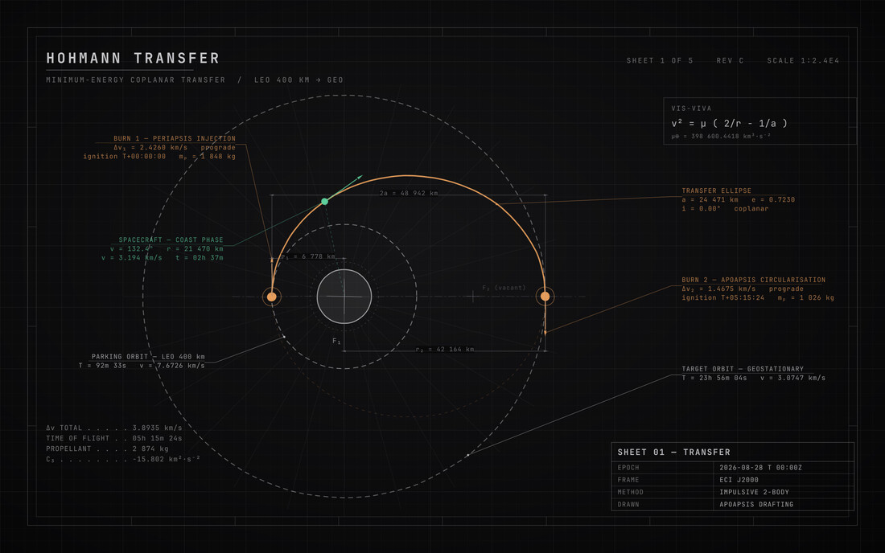
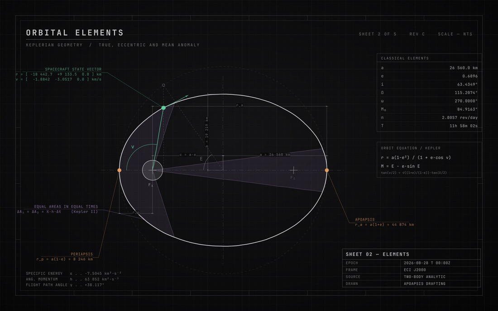
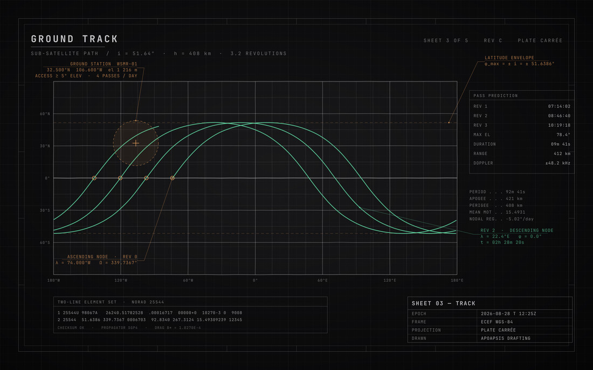
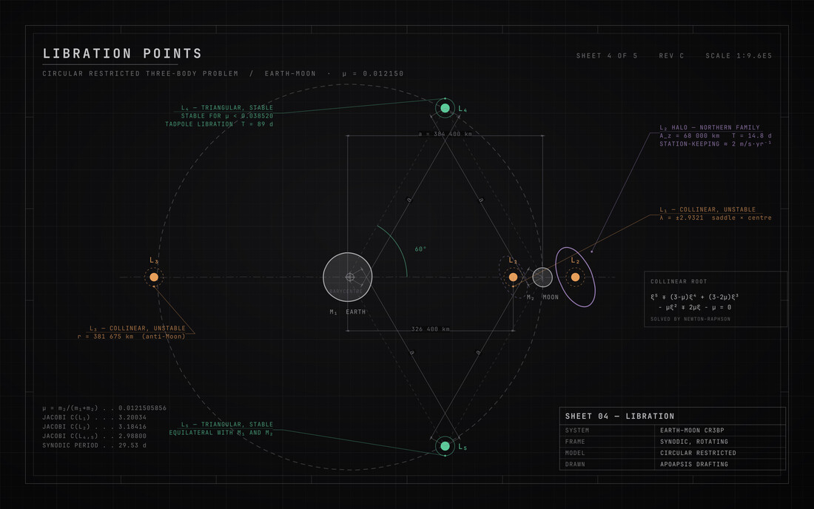
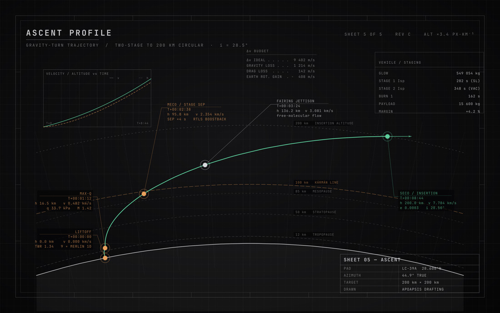
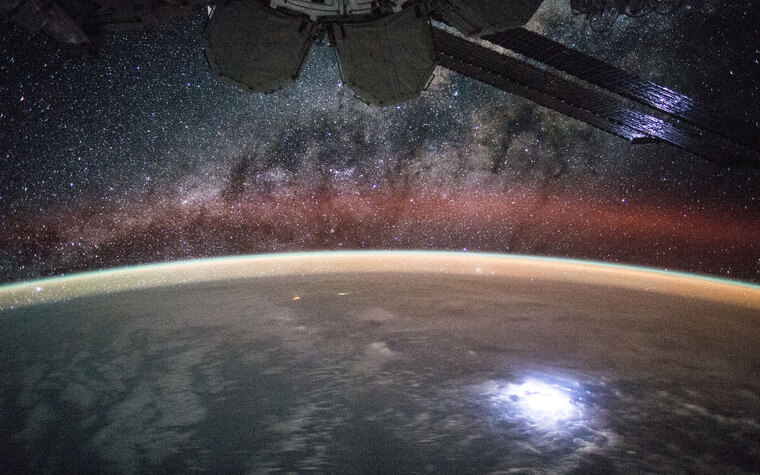
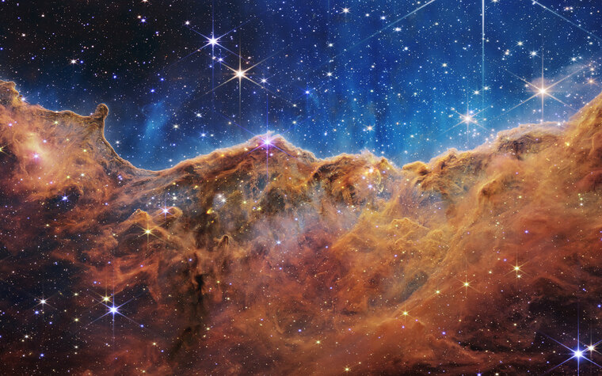
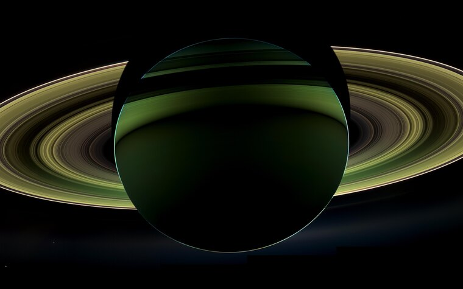
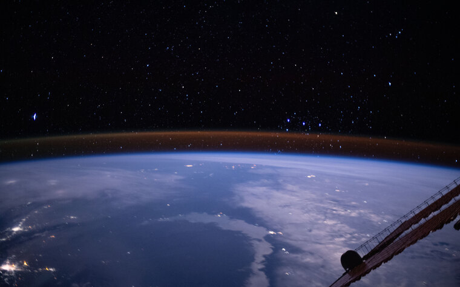
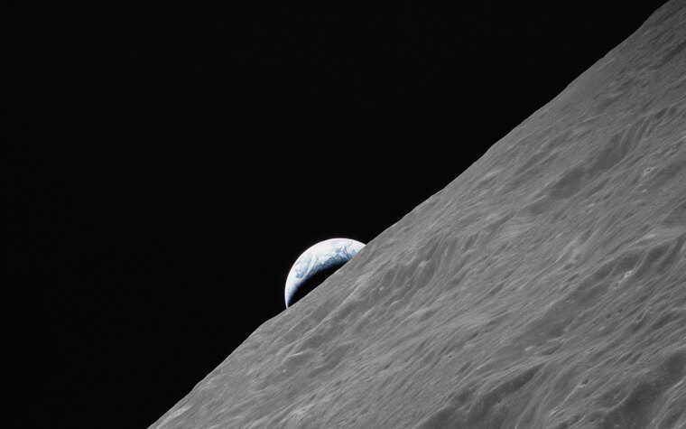

# omarchy-themes

Two themes for [Omarchy](https://omarchy.org/), plus everything needed to
regenerate them from source.

| Theme | Look | Backgrounds |
|---|---|---|
| [`hohmann`](hohmann/) | Monochrome drafting — graphite paper, white ink, colour only where the sheet annotates something | 5 original engineering sheets, generated from SVG |
| [`apoapsis`](apoapsis/) | Deep-space navy with an ion-blue accent | 5 NASA public-domain photographs |

---

## Hohmann

Every background is an original engineering sheet — computed geometry rendered
to SVG at 2880×1800, not traced or downloaded. Grid, border zone ticks,
dimension lines with arrowheads, leader callouts, and a title block on each.

Colour is reserved for what the drawing actually annotates: **amber** for burns
and callouts, **green** for the live trajectory, **violet** for swept area and
halo orbits. Everything else is graphite and white ink.


*Sheet 1 — Hohmann transfer, LEO 400 km → GEO. Both impulsive burns with Δv
vectors, the transfer ellipse, vis-viva.*


*Sheet 2 — Keplerian geometry. True and eccentric anomaly construction against
the auxiliary circle; the two shaded sectors are solved numerically to equal
area (Kepler II).*


*Sheet 3 — Ground track at i = 51.64°, 3.2 revolutions, propagated from the
spherical-Earth ground-track equations with the correct nodal regression.*


*Sheet 4 — Earth–Moon CR3BP. L₁–L₅ with a genuinely equilateral L₄/L₅
construction, an L₂ halo orbit, and the collinear quintic.*


*Sheet 5 — Two-stage gravity turn to 200 km over the curved limb: vertical
rise, pitch-over, flattening climb, with atmosphere layers and event callouts.*

The hand-drawn wobble is an SVG `feTurbulence` + `feDisplacementMap` filter
applied to the geometry only — annotation text stays crisp.

## Apoapsis

NASA public-domain imagery, cropped to the wallpaper aspect. Per-image credit
in [`apoapsis/CREDITS.md`](apoapsis/CREDITS.md).

| | | |
|---|---|---|
|  |  |  |
|  |  | |

---

## Install

```bash
git clone https://github.com/Nano112/omarchy-themes.git
cd omarchy-themes
./install.sh hohmann     # build, copy into ~/.config/omarchy/themes, apply
./install.sh apoapsis
```

> This is a multi-theme repo, so it is **not** compatible with
> `omarchy theme install <url>` — that command expects a single theme at the
> repository root. Use `install.sh`.

Each theme also builds standalone, without installing:

```bash
./hohmann/build.sh              # sheets -> hohmann/backgrounds/, glyph -> hohmann/unlock.png
./apoapsis/build.sh 3840x2160   # optional target size
```

## Requirements

- `python3` (standard library only)
- `rsvg-convert` — Arch: `librsvg`
- `magick` — Arch: `imagemagick` (apoapsis only, for cropping)
- `curl` (apoapsis only)
- JetBrainsMono Nerd Font, for the sheet annotations

## Layout

```
hohmann/
  colors.toml  icons.theme  neovim.lua  CREDITS.md
  build.sh
  backgrounds/     rendered sheets (committed, but fully regenerable)
  src/
    common.py      palette + drafting primitives shared by every sheet
    s1..s5.py      one sheet each
    unlock.py      lock-screen glyph
apoapsis/
  colors.toml  icons.theme  neovim.lua  CREDITS.md
  build.sh
  fetch-backgrounds.sh   NASA image download + crop
  unlock.py
  backgrounds/
install.sh
preview/           README thumbnails
```

## Re-skinning

Every colour in the Hohmann sheets comes from one block at the top of
[`hohmann/src/common.py`](hohmann/src/common.py):

```python
BG_MID, BG_EDGE       # paper gradient
INK, INK_DIM          # drafting ink, construction lines
AMBER, GREEN, VIOLET  # accents
```

Change those, run `./install.sh hohmann`, and all five sheets plus the lock
glyph re-render together. Keep `hohmann/colors.toml` in step so the desktop
matches the wallpapers.

## Credits

NASA imagery is public domain under NASA's media usage guidelines; per-image
credit is in [`apoapsis/CREDITS.md`](apoapsis/CREDITS.md). The drafting sheets,
scripts, and palettes are original work.
